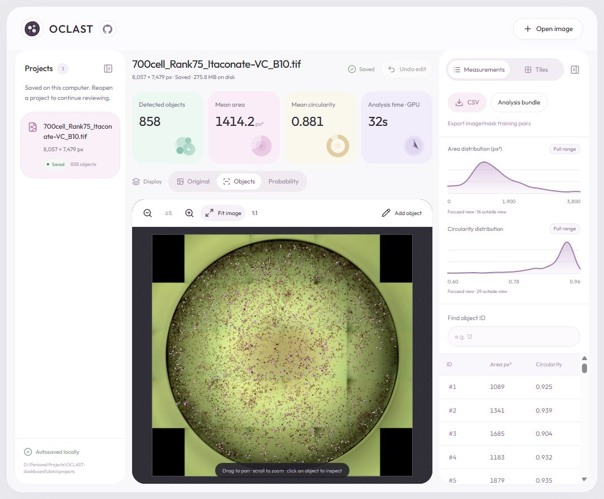
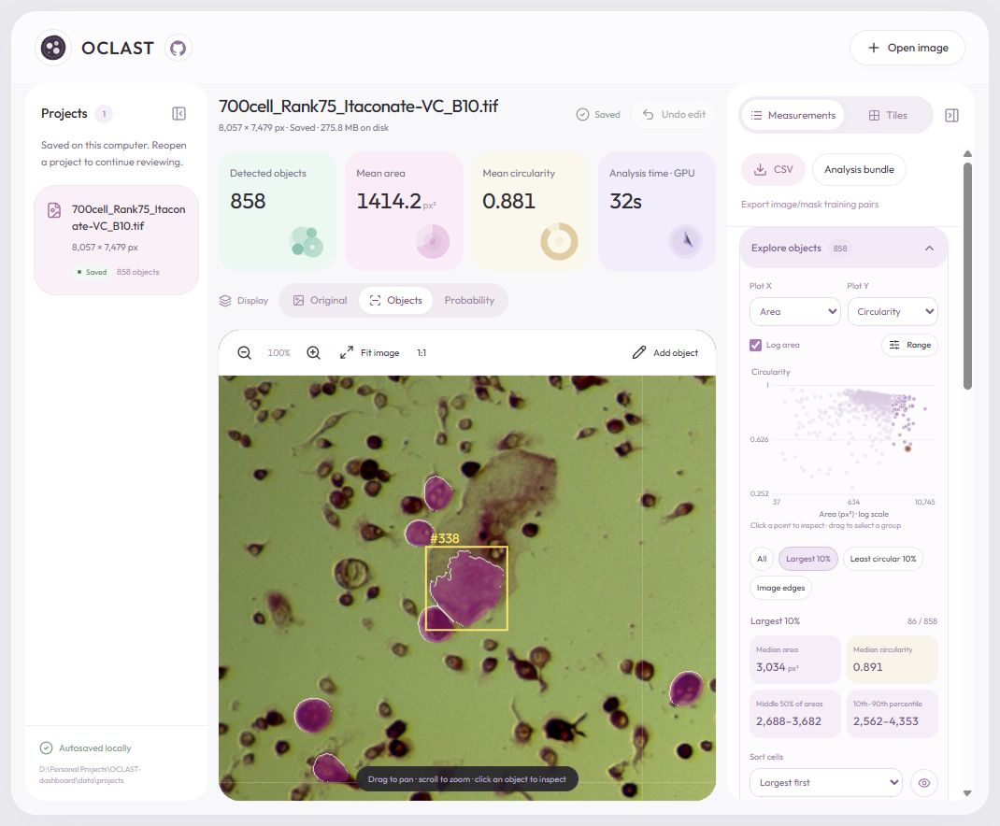

# OCLAST Dashboard

[](https://github.com/yuvipaloozie/OCLAST-dashboard/releases/latest)


**Whole-image osteoclast segmentation, mask review, and descriptive measurements on your own computer.**

Built for TRAP-stained bright-field images, OCLAST bundles its U-Net++ model, interface, and inference runtime into one Windows executable. No Python installation, cloud account, or hosted GPU is needed.

[**Download for Windows**](https://github.com/yuvipaloozie/OCLAST-dashboard/releases/latest) · [Paper & research code](https://github.com/yuvipaloozie/OCLAST) · [Report an issue](https://github.com/yuvipaloozie/OCLAST-dashboard/issues)



## Start analyzing

1. Download **OCLAST.exe** from the [latest release](https://github.com/yuvipaloozie/OCLAST-dashboard/releases/latest), rather than the Source code archives.
2. Close any previous OCLAST instance, then double-click the executable. After unpacking, it opens your browser at `http://127.0.0.1:8000`.
3. Choose **Open image**, then **Analyze image**. Review the saved masks and export your results.

Keep the OCLAST console window open while working. Close it to stop the app; closing the browser tab alone does not stop the service. The executable is unsigned, so Windows may show an unrecognized-publisher notice.

**Input:** a single 8-bit RGB TIFF, PNG, or JPEG. Convert grayscale, 16-bit, alpha-channel, or stack data before analysis. Large scans require available memory and disk space.

## Review and explore

| Feature | What it provides |
| --- | --- |
| Whole-image viewer | Fit, pan, zoom, and inspect native pixels. Switch between original, object masks, and foreground probability. |
| Continuous tile library | Browse every region, toggle overlays, and jump to a tile. Empty regions and partial edge tiles are included. |
| Cell inspection | Click a detection to view its area and circularity, or find it by object ID. |
| Morphology distributions | Area and circularity KDEs with focused/full ranges and an explicit count of objects outside the focused view. |
| Object explorer | Linked shape plots, sortable cell crops, group selections, and descriptive summaries. |
| Manual review | Add a polygon, remove a detection, and undo the last edit. Saved masks and measurements update together. |
| Local projects and exports | Reopen results without rerunning inference; export measurements, masks, or training pairs. |

Objects spanning multiple tiles keep one global identity and are counted once. Tile counts use object centers; neighboring thumbnails may show different parts of the same mask. Overlapping manual additions are rejected to prevent duplicate counts.

### Explore objects

Expand **Explore objects** in Measurements to plot area, circularity, solidity, or eccentricity. Optional log scaling spreads broad area distributions without changing stored values.

- Click a point to locate its mask. Ctrl/Shift-click adjusts the selection; drag a box or use **Range** for numeric limits.
- Select the largest 10%, least circular 10%, or image-edge masks for review.
- Inspect median area, median circularity, the middle 50% of areas, and 10th–90th percentiles for the selected objects.
- Browse individual cell crops, sort by shape or size, and toggle each crop's mask overlay. Crops load on demand without extra saved image copies.

<details>
<summary>Object explorer preview</summary>



</details>

## GPU, storage, and exports

The Windows release uses **ONNX Runtime DirectML** on compatible GPUs, with automatic CPU retry if GPU execution fails. A separate CUDA toolkit is not required. Each saved run records GPU, CPU, or mixed execution. Preprocessing, object separation, and saving remain CPU tasks.

One packaged-app test processed an **8,057 × 7,479-pixel** image in **33.47 seconds** on an RTX 3060 Ti, excluding import. Timings vary by hardware and image; release validation records are in [docs/releases](docs/releases).

All analysis runs locally; images are not uploaded to a hosted service. Fonts and interface assets are bundled for offline use.

| Run mode | Saved projects |
| --- | --- |
| Windows executable | `%LOCALAPPDATA%\OCLAST\projects\` |
| Source checkout | `data/projects/` |
| Custom directory | Set `OCLAST_DATA_DIR` before starting |

Projects retain one lossless source PNG, compressed predictions and instance labels, measurements, processing settings, and review state. One undo snapshot is retained. Back up the **entire project folder** to preserve an editable analysis. Interrupted jobs can be rerun, but partially completed inference is not resumed.

- **CSV:** object IDs, centroids, area, circularity, solidity, eccentricity, and manual-review flags.
- **Analysis bundle:** metadata, measurements, instance labels, and a foreground mask; it does not replace the full project folder.
- **Training pairs:** lossless image/mask PNGs for every tile, including empty and partial edge regions.

## Measurement scope

This release provides **image-level morphology**, without experiment, treatment, well-size, or replicate metadata. Areas are in pixels². Physical calibration, well-region analysis, split/merge editing, and treatment comparisons are deferred.

V9 preprocessing and 512 × 512 prediction tiles feed the bundled model. Predictions are stitched, thresholded at `> 0.5`, and separated with watershed; objects larger than 50 pixels are retained. Counts, overlays, and exports use the same instance-label map.

Mask measurements do not establish nuclei counts, fusion, multinuclearity, or resorptive activity. Extreme shapes and edge contact are review cues, not biological classifications. Staining, seams, truncation, and segmentation errors can affect measurements; inspect the overlays. Foreground scores are not calibrated certainty of biological correctness.

## Development

Tested with **Python 3.12** and **Node.js 24**. Clone with Git LFS to retrieve model weights:

```powershell
git clone https://github.com/yuvipaloozie/OCLAST-dashboard.git
cd OCLAST-dashboard
git lfs pull
python -m venv .venv
.venv\Scripts\python.exe -m pip install -r requirements.txt
cd frontend
npm ci
npm run build
cd ..
.venv\Scripts\python.exe api.py
```

See the [development guide](docs/DEVELOPMENT.md) for live frontend development, verification, Windows packaging, and runtime overrides. The supported entry point is `api.py`; historical scripts remain in `Legacy Scripts/`.

The [OCLAST research repository](https://github.com/yuvipaloozie/OCLAST) contains the paper, training curriculum, and evaluation. Interface typography uses [Outfit](frontend/public/fonts/OFL-Outfit.txt) under the SIL Open Font License; see [design notes](frontend/DESIGN.md) and [dependency notices](packaging/licenses/INDEX.txt).
